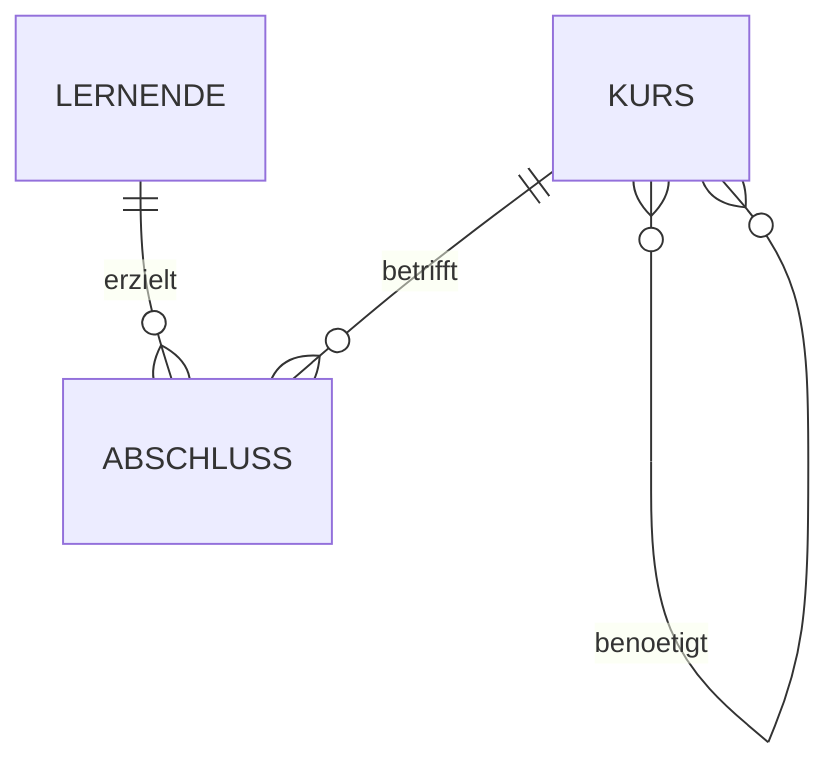
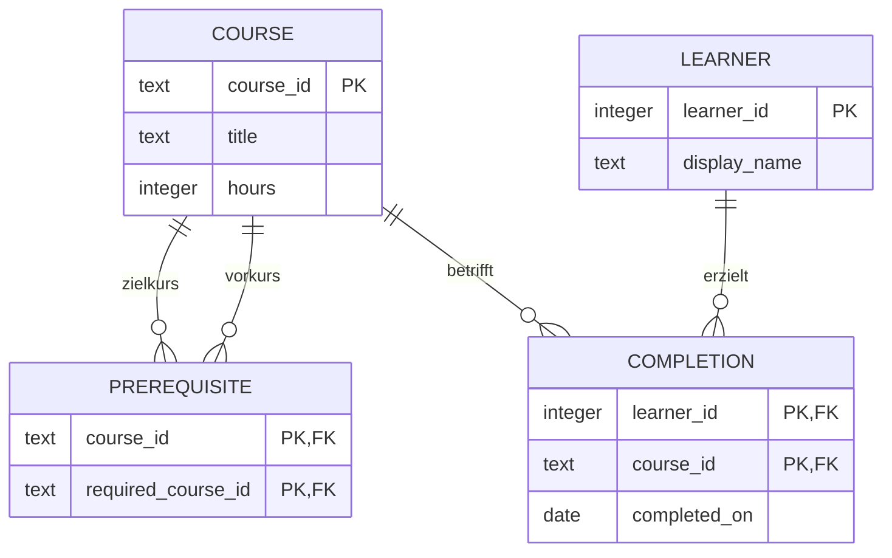

# LE2-Draft: Kursvoraussetzungen und Lernpfadplanung

**Modul:** Datenbankdesign und Implementierung · **Route:** MC3, Vergleich SQL/NoSQL · **Stand:** 19.10.2026 · **Besprechung:** 22.10.2026

Dieser Draft enthält die ausgearbeitete Problemstellung, das konzeptionelle und relationale Modell sowie eine getestete PostgreSQL-Umsetzung mit synthetischen Daten. Er ist die LE2-Grundlage der gewählten gemeinsamen MC3-Abgabe. Die NoSQL-Implementierung und der empirische Vergleich folgen in LE3. Die persönliche Reflexion wird nach deiner eigenen Arbeit ergänzt.

**Arbeitsumfang:** MC3 ist die gemeinsame Abgaberoute für LE2 und LE3. Alle zwölf Bewertungskriterien werden anhand dieses einen Beispiels bearbeitet. Nach dem Modulporträt betreffen die beiden Abgaben zusammen 40 % der Modulnote; die schriftliche Modulschlussprüfung mit 60 % bleibt eine eigene Leistung. [Q01, Q03/Q05](#12-quellen)

## 1. Problemstellung und Ziel

Ein fiktiver Weiterbildungsanbieter möchte Lernende bei der Auswahl ihrer nächsten Kurse unterstützen. Manche Kurse setzen andere Kurse voraus. Diese Voraussetzungen können mehrere Stufen tief reichen und sich verzweigen: Ein Projekt benötigt beispielsweise Kenntnisse aus Datenpipelines, Machine Learning und NoSQL; diese Bereiche bauen ihrerseits auf Grundlagenkursen auf.

Eine einfache Liste unmittelbar benötigter Kurse genügt deshalb nicht. Für einen Zielkurs müssen sämtliche direkten und indirekten Voraussetzungen ermittelt werden. Bereits abgeschlossene Kurse sollen dabei berücksichtigt werden. Der Anbieter benötigt Antworten auf vier Fragen:

| ID | Fachliche Frage | Parameter im Beispiel |
| --- | --- | --- |
| A-001 | Welche Kurse sind direkte Voraussetzungen eines Zielkurses? | Zielkurs `PROJ` |
| A-002 | Welche unterschiedlichen Kurse sind insgesamt vorausgesetzt, auch über mehrere Stufen? | Zielkurs `PROJ` |
| A-003 | Welche noch nicht abgeschlossenen Kurse darf eine Person als Nächstes besuchen? | Person `1` |
| A-004 | Welche Voraussetzungen fehlen einer Person für einen Zielkurs, und wie viele Kursstunden umfassen sie? | Zielkurs `PROJ`, Person `1` |

Mit „Lernpfadplanung“ ist hier das Ermitteln zulässiger nächster Kurse und der verbleibenden Voraussetzungen gemeint. Eine terminierte Kursreihenfolge oder ein kürzester Lernpfad wird in diesem Draft nicht berechnet. Die Stundensumme beschreibt den Umfang fehlender Vorkurse und enthält den Zielkurs selbst nicht.

Die Problemstellung erfüllt das MC3-Mindestmerkmal eines nicht trivialen relationalen Modells: Voraussetzungen und Abschlüsse benötigen mehrere Fremdschlüssel. Gleichzeitig besitzt die Fragestellung eine natürliche Graphstruktur. Die fachlichen Anforderungen stammen aus dem [MC3-Auftrag Q03/Q05](#12-quellen); der Use-Case und alle Beispieldaten sind eigene Entwurfsentscheidungen.

## 2. Auswahl der Datenbanken

Für LE2 wird **PostgreSQL 18.6** eingesetzt. Die benötigten Beziehungen lassen sich mit Primär- und Fremdschlüsseln ausdrücken; rekursive SQL-Abfragen unterstützen die mehrstufige Suche. Der Draft ist mit dem offiziellen Docker-Image `postgres:18.6-alpine` ausgeführt worden. Die Compose-Datei fixiert zusätzlich dessen getesteten SHA-256-Image-Digest. Die lokale PostgreSQL-Installation auf deinem Rechner wird dafür nicht benötigt.

Als NoSQL-Vergleich für LE3 ist **Neo4j** ausgewählt. Vorgesehen sind Knoten für Kurse und Lernende sowie gerichtete Beziehungen für Voraussetzungen und Abschlüsse. Variable Pfadmuster in Cypher passen zur Suche über unterschiedlich viele Voraussetzungen. Das ist eine begründete Auswahl, aber noch kein Nachweis besserer Laufzeiten. Die spätere Untersuchung muss auch Ergebnisse zulassen, bei denen SQL gleich gut oder besser abschneidet. [Technische Grundlagen T01, T03](#12-quellen)

Der Umfang bleibt für einen Draft bewusst klein: vier Relationen, vier Vergleichsfragen und ein überschaubarer Datenbestand. Die technische Ausführbarkeit und fachliche Korrektheit werden zuerst an diesem nachvollziehbaren Beispiel geprüft. Für belastbare Laufzeitmessungen sind später grössere, in beiden Systemen identische Datensätze erforderlich.

## 3. Fachliche Regeln

1. Jeder Kurs hat einen eindeutigen Kurscode, einen Titel und einen positiven Stundenumfang.
2. Eine lernende Person hat eine eindeutige ID und einen Anzeigenamen. Anzeigenamen sind keine Schlüssel.
3. Ein Kurs kann keinen, einen oder mehrere andere Kurse voraussetzen; derselbe Kurs kann Voraussetzung mehrerer Zielkurse sein.
4. Mehrere Voraussetzungen gelten gemeinsam als **UND-Bedingung**. Alternative Zugangswege mit ODER-Logik gehören nicht zum Beispiel.
5. Ein Kurs darf sich nicht unmittelbar selbst voraussetzen. Auch längere Zyklen sind fachlich ungültig, da sonst keine erfüllbare Reihenfolge entsteht.
6. Pro Person und Kurs wird höchstens ein bestätigter Abschluss mit Datum gespeichert. Wiederholungsversuche, Noten und Kursangebote mit Kalenderterminen sind nicht modelliert.
7. Als nächster Kurs gilt ein noch nicht abgeschlossener Kurs, dessen direkte und indirekte Voraussetzungen vollständig abgeschlossen sind. Für unbekannte Personen werden keine Empfehlungen ausgegeben.
8. Ein Vorkurs, der über mehrere Wege erreicht wird, zählt fachlich nur einmal. Das gilt auch für die Stundensumme.

Abschlüsse werden als bestätigte Fakten erfasst. Ihre Speicherung prüft die referenzierten Personen und Kurse, aber keine historische Reihenfolge der Abschlussdaten. Die Empfehlung prüft die aktuell gespeicherte gesamte Voraussetzungskette.

## 4. Konzeptionelles Modell

Es gibt die fachlichen Objekte **Kurs** und **Lernende Person**. Ein **Abschluss** verbindet eine Person mit einem Kurs und besitzt das Attribut Abschlussdatum. Zwischen Kursen besteht die gerichtete Beziehung „benötigt“. Ein Abschluss gehört genau einer Person und genau einem Kurs; beide können jeweils mehrere Abschlüsse besitzen.

Die rekursive Beziehung bezieht sich zweimal auf denselben Entitätstyp `KURS`: auf den Zielkurs und auf den benötigten Vorkurs. Ihre Richtung lautet **Zielkurs → Voraussetzung**. Die 0..n-Kardinalität an beiden Rollen erlaubt Grundlagenkurse ohne Voraussetzung und gemeinsam genutzte Vorkurse. Der Mermaid-Block lässt sich mit einer Mermaid-fähigen Markdown-Vorschau darstellen; die folgende relationale Darstellung macht die beiden Rollen explizit.

## 5. Relationales Modell und Normalisierung

| Relation | Attribute | Primärschlüssel | Fremdschlüssel |
| --- | --- | --- | --- |
| `course` | `course_id TEXT`, `title TEXT`, `hours INTEGER` | `course_id` | – |
| `learner` | `learner_id INTEGER`, `display_name TEXT` | `learner_id` | – |
| `prerequisite` | `course_id TEXT`, `required_course_id TEXT` | Beide Attribute gemeinsam | Beide Attribute → `course.course_id` |
| `completion` | `learner_id INTEGER`, `course_id TEXT`, `completed_on DATE` | `learner_id, course_id` | `learner_id` → `learner`; `course_id` → `course` |

Die beiden m:n-Beziehungen werden durch `prerequisite` und `completion` aufgelöst. Ihre zusammengesetzten Primärschlüssel verhindern doppelte Voraussetzungen und doppelte Abschlüsse. Ein zusätzlicher technischer Schlüssel ist für diese Zuordnungstabellen nicht erforderlich.

Die Attribute enthalten einzelne Werte und keine Kurslisten; damit liegt die erste Normalform vor. In `completion` hängt das Abschlussdatum von der vollständigen Kombination aus Person und Kurs ab. Kurstitel und Stunden werden ausschliesslich in `course` gespeichert und hängen dort vom Kurscode ab. Der Anzeigename hängt von der Personen-ID ab. Unter diesen fachlichen Annahmen bestehen keine partiellen oder transitiven Abhängigkeiten der Nichtschlüsselattribute; das Modell ist in der dritten Normalform. Änderungen eines Kurstitels erfordern daher keine Anpassung aller Abschlüsse oder Voraussetzungskanten.

Alle fachlichen Attribute sind `NOT NULL`. `CHECK` sichert positive Stunden, nicht leere Texte, das Kurscodeformat und unterschiedliche Kurse einer direkten Voraussetzung. Fremdschlüssel verwenden `ON UPDATE CASCADE` und `ON DELETE RESTRICT`. Eine Schlüsselkorrektur bleibt damit konsistent; das Löschen eines noch referenzierten Kurses oder einer referenzierten Person wird abgewiesen. [T02](#12-quellen)

**Grenze der Integritätssicherung:** Der lokale `CHECK` verhindert nur die unmittelbare Selbstkante. Mehrstufige Zyklen werden von `le2.prerequisite_cycles()` und der Prüfung vor der Freigabe erkannt. Sie werden nicht automatisch bei jeder Schreiboperation durch einen Trigger verhindert. Der Draft bildet einen kontrollierten Einzelbenutzer-Import ab; ein Mehrbenutzersystem benötigte dafür eine zusätzliche, transaktionssichere Schreibregel.

## 6. Ausgangsdaten und Import

Alle Daten sind eigens für dieses Beispiel formuliert. Es werden weder echte Personendaten noch ein tatsächliches FHNW-Curriculum verwendet. Die Ausgangsquelle ist der `VALUES`-Abschnitt in [datenbank.sql](le2/datenbank.sql), Datenstand **`le2-synthetic-v1`**.

| Code | Kurs | Stunden | Direkte Voraussetzungen |
| --- | --- | --- | --- |
| EIN | Digitale Grundlagen | 4 | – |
| SQL | SQL-Grundlagen | 8 | EIN |
| MOD | Datenmodellierung | 6 | EIN |
| PY | Python-Grundlagen | 8 | EIN |
| STAT | Statistik-Grundlagen | 6 | EIN |
| NOSQL | NoSQL-Grundlagen | 8 | MOD, SQL |
| ML | Machine Learning | 10 | PY, STAT |
| DE | Datenpipelines | 10 | SQL, PY |
| PROJ | Data-Science-Projekt | 12 | DE, ML, NOSQL |
| VIS | Datenvisualisierung | 6 | PY |

| Person | Bestätigte Abschlüsse |
| --- | --- |
| 1 / Lernende A | EIN am 01.09.2026; SQL am 15.09.2026; MOD am 16.09.2026 |
| 2 / Lernende B | EIN am 01.09.2026; PY am 15.09.2026; STAT am 16.09.2026 |
| 3 / Lernende C | EIN am 01.09.2026 |

Der Import erfolgt innerhalb einer Transaktion: erst Kurse und Personen, danach Voraussetzungen und Abschlüsse. So bestehen die referenzierten Schlüssel bereits. `ON CONFLICT ... DO NOTHING` verhindert Duplikate bei erneutem Start. Bestehende Werte werden dabei nicht überschrieben. Es handelt sich um einen wiederholbaren Demo-Import, nicht um eine allgemeine Schema- oder Datenmigration. Änderungen an vorhandenen Tabellen benötigen später passende `ALTER`-Anweisungen; `CREATE TABLE IF NOT EXISTS` migriert keine Strukturänderungen.

Der Sollbestand umfasst **10 Kurse, 3 Personen, 14 Voraussetzungskanten und 7 Abschlüsse**. Die feste Beispielprüfung setzt genau diesen Bestand voraus. Wenn du Daten bewusst erweiterst, musst du die erwarteten Prüfergebnisse entsprechend anpassen.

## 7. Physische Umsetzung und Abfragen

Alle Objekte liegen im Schema `le2` einer eigenen Docker-Datenbank. [datenbank.sql](le2/datenbank.sql) enthält DDL, Beispieldaten, Abfragefunktionen und die Exportansicht. [abfragen.sql](le2/abfragen.sql) demonstriert die vier Vergleichsfragen und CRUD.

**A-001 – direkte Voraussetzungen:** Ein Join verbindet `prerequisite.required_course_id` mit `course.course_id`. Die Auswahl erfolgt über den Zielkurs. Es wird eine sortierte Kursmenge ausgegeben.

**A-002 – alle Voraussetzungen:** `le2.all_prerequisites()` verwendet `WITH RECURSIVE`. Der Anker liefert die direkten Voraussetzungen, der rekursive Schritt deren weitere Voraussetzungen. `UNION` bildet eine eindeutige Menge aus Kurscodes. Dadurch wird ein gemeinsam benötigter Kurs nicht mehrfach gezählt; die Rekursion bleibt auch bei fehlerhaften Zyklendaten endlich. Die separate Zyklusprüfung meldet solche Daten als fachlich ungültig. [T01](#12-quellen)

**A-003 – zulässige nächste Kurse:** `le2.eligible_courses()` schliesst abgeschlossene Kurse aus und prüft mit verschachtelten `NOT EXISTS`, dass keine unerfüllte Voraussetzung existiert. Dabei wird die gesamte transitive Voraussetzungskette berücksichtigt.

**A-004 – noch fehlende Voraussetzungen:** `le2.missing_prerequisites()` zieht die bereits abgeschlossenen Kurse von der transitiven Voraussetzungskette ab. Die verbleibenden eindeutigen Kurse werden anschliessend gezählt und ihre Stunden summiert.

Die zusammengesetzten Primärschlüssel unterstützen die Suche vom Zielkurs zu Voraussetzungen beziehungsweise von der Person zu Abschlüssen. Zwei zusätzliche Indizes beginnen mit `required_course_id` beziehungsweise `course_id` und unterstützen die umgekehrte Suche. Das sind begründete Ausgangsentscheidungen. Im kleinen Datensatz kann PostgreSQL trotzdem einen sequenziellen Scan wählen; die Existenz eines Index beweist keinen Laufzeitvorteil. [T04](#12-quellen)

`abfragen.sql` führt ausserdem `INSERT`, `UPDATE` und `DELETE` an einem temporär hinzugefügten Demokurs sowie einen zusätzlichen Abschluss vor. Der gesamte Demonstrationsblock endet mit `ROLLBACK`; danach bleibt der Ausgangsbestand unverändert. `EXPLAIN (ANALYZE, BUFFERS)` zeigt zusätzlich den Ausführungsplan einer rekursiven Abfrage. Seine lokale Einzelmessung wird nicht als SQL/NoSQL-Benchmark interpretiert.

## 8. Tatsächlich ausgeführte Prüfungen

Am **19.10.2026** wurden die Skripte in **PostgreSQL 18.6, Docker/Linux x86_64** ausgeführt. **Alle 25 Prüfungen sind bestanden.** Sie lassen sich mit [pruefung.sql](le2/pruefung.sql) erneut ausführen. Der Start zeigt die vollständigen Prüfungen und die Ergebnisse von [abfragen.sql](le2/abfragen.sql) direkt im Terminal; zusätzliche Protokolldateien werden nicht angelegt.

| Bereich | Prüfungen | Tatsächlich geprüftes Ergebnis |
| --- | --- | --- |
| Vollständigkeit und Abfragen | P01–P09 | Sollmengen, direkte/transitive Voraussetzungen, zwei Empfehlungssituationen, unbekannte Person, fehlende Stunden und Azyklizität |
| Negative Integritätstests | P10–P16 | Ungültige Fremdschlüssel, Selbstkante, Nullstunden, doppelte Zuordnungen und Löschen eines referenzierten Kurses werden abgewiesen |
| Export/Import | P17–P20 | JSON-Export wird in vier temporäre Tabellen zurückgelesen; der beidseitige Mengenvergleich entspricht den Originalen |
| CRUD und Transaktionen | P21–P25 | Einfügen/Ändern/Löschen, Erkennen eines absichtlich eingefügten längeren Zyklus, geänderte Empfehlungen und Wiederherstellung nach Rollback |

Die wichtigsten kontrollierten Abfrageergebnisse lauten:

| Frage | Ergebnis |
| --- | --- |
| A-001, PROJ | `DE, ML, NOSQL` |
| A-002, PROJ | `DE, EIN, ML, MOD, NOSQL, PY, SQL, STAT` |
| A-003, Person 1 | `NOSQL, PY, STAT` |
| A-003, Person 2 | `ML, MOD, SQL, VIS` |
| A-004, PROJ und Person 1 | `DE, ML, NOSQL, PY, STAT`: **5 Kurse, 42 Stunden** |

Die Prüfungen belegen das Verhalten des kleinen Beispielbestands und ausgewählter Fehlerfälle. Sie belegen noch keine Skalierbarkeit, Mehrbenutzerfestigkeit oder bessere Leistung gegenüber einer anderen Datenbank.

## 9. Export und Anschluss an LE3

Die Ansicht `le2.export_data` stellt den fachlichen Datenbestand als sortiertes JSON bereit. Mit `start.ps1 -Aktion Export` wird bei Bedarf `le2/ergebnisse/datenexport.json` erzeugt. Die Datei enthält Datenstand, Kurse, Personen, Voraussetzungen und Abschlussdaten; sie ist der vorgesehene gemeinsame Eingabestand für den späteren Neo4j-Import. Beide Datenbanken sollen nicht unabhängig voneinander mit neu erzeugten Beispieldaten gefüllt werden.

Für Neo4j ist folgende Abbildung vorgesehen: `course` wird zu `Course`, `learner` zu `Learner`, eine Voraussetzung zu `(Course)-[:REQUIRES]->(Course)` und ein Abschluss zu `(Learner)-[:COMPLETED {completed_on}]->(Course)`. Die Eindeutigkeit der Kurs- und Personen-IDs sowie gleiche Ergebnissemantik müssen bei der LE3-Implementierung geprüft werden. Die NoSQL-Umsetzung ist in diesem LE2-Draft noch nicht implementiert.

## 10. Geplanter Vergleich und erwartete Vorteile

Die Arbeitshypothese lautet: Eine Graphdatenbank könnte die mehrstufigen Beziehungen direkter ausdrücken und für bestimmte Abfrage- und Datenformen Vorteile haben. Daraus wird ausdrücklich keine allgemeine Geschwindigkeitsaussage abgeleitet. SQL kann denselben fachlichen Bedarf bereits korrekt erfüllen.

| Kriterium | Geplante Operationalisierung | Stand |
| --- | --- | --- |
| Korrektheit | Für dieselben Parameter identische sortierte Ergebnismengen und Stundensummen | SQL geprüft; Neo4j-Abgleich offen |
| Abfragelatenz | Dauer vollständiger A-002-/A-004-Abfragen mit identischer Ergebnisübertragung; Median und Streuung aus wiederholten Läufen | Noch nicht gemessen |
| Skalierungsverhalten | Dieselben Abfragen für gemeinsam erzeugte Datenbestände; Kurs-/Kantenzahl und maximale Tiefe separat dokumentieren | Datengenerator und Messreihe folgen |

Vor den Hauptmessungen sind Messgrenzen, Indizes, Ressourcen, Cachezustand und Wiederholungen festzulegen. Der kleine Funktionsdatensatz bleibt ein Korrektheitsbeispiel und wird nicht zum Beweis eines Laufzeitvorteils verwendet. Die finale Messplanung wird direkt in diesem Abschnitt festgehalten; die Termine stehen in Abschnitt 14. Die PostgreSQL-Dokumentation empfiehlt wiederholte, ausreichend lange Läufe, um zufällige Schwankungen einzuordnen. [T05](#12-quellen)

**Kompakter Vergleichsplan:** Alle vier fachlichen Fragen werden in SQL und Neo4j korrekt umgesetzt. Gemessen werden die beiden zentralen Fragen A-002 und A-004 auf zwei im Pilot festgelegten, reproduzierbaren Datenumfangsstufen. Je Kombination aus Abfrage, Datenumfang und System sind zunächst fünf Messläufe vorgesehen, insgesamt 40 Läufe. Messgrenzen, Aufwärmphase und gleiche Ressourcen werden vorher dokumentiert; bei hoher Streuung wird begründet nachgemessen. Das ist ein internes Arbeitsziel und keine vorgegebene Mindestzahl. Verständlichkeit wird kurz anhand der Abfrageformulierungen eingeordnet.

## 11. Reflexion und Besprechung

Als fachliches Zwischenergebnis zeigt der Draft, dass mehrere Abfrageebenen auf einer normalisierten relationalen Struktur abgebildet werden können. Ein besonders wichtiger Entwurfsentscheid ist die Mengensemantik: Gemeinsam vorausgesetzte Grundlagen müssen dedupliziert werden. Ausserdem unterscheiden sich lokale Integritätsregeln wie Fremdschlüssel und Selbstkantenverbot von globalen Regeln wie der Azyklizität des gesamten Voraussetzungsgrafen.

**Dein persönlicher Teil bleibt wahrheitsgemäss zu ergänzen:**

- Welche SQL- und Modellierungserfahrungen hattest du vor dieser Arbeit?
- Welche Erkenntnis war nach dem eigenen Ausführen und Verändern für dich neu?
- Welche Schwierigkeiten und Entscheidungen haben deinen Lernerfolg beeinflusst?

Diese Antworten werden nicht als bereits erlebte Erfahrungen vorformuliert. Für die Kontaktstunde am **22.10.2026** sind folgende Fragen vorbereitet: Ist der Use-Case für MC3 ausreichend? Sind die beiden Modelle korrekt notiert? Ist der geplante SQL/Neo4j-Vergleich fachlich sinnvoll? Welche Seitenregel und welches Bewertungsraster gelten für die finale Abgabe?

## 12. Quellen

| ID | Quelle | Verwendung |
| --- | --- | --- |
| Q01 | [Modulporträt](context/MC3_QUELLEN.md#q01-modulportraet) | LE2-Drafttermin 22.10.2026 und Modulrahmen |
| Q03/Q05 | [MC3-Auftrag DE](context/mc3_auftrag_de.pdf), [EN](context/mc3_auftrag_en.pdf) | Problemstellung, mindestens ein FK, Modelle, gleiche Daten, separate Skripte, Bericht |
| Q04/Q06 | [MC3-Raster DE](context/mc3_bewertung_de.pdf), [EN](context/mc3_bewertung_en.pdf) | Anforderungsabdeckung und Schwerpunkte |
| T01 | [PostgreSQL 18: rekursive WITH-Abfragen](https://www.postgresql.org/docs/18/queries-with.html) | Mehrstufige Abfragen und Terminierung durch Mengensemantik |
| T02 | [PostgreSQL 18: Constraints](https://www.postgresql.org/docs/18/ddl-constraints.html) | PK, FK, CHECK und Referenzaktionen |
| T03 | [Neo4j: Variable-length paths](https://neo4j.com/docs/cypher-manual/current/patterns/variable-length-paths/) | Begründung der späteren Graphdatenbank-Auswahl |
| T04 | [PostgreSQL 18: mehrspaltige Indizes](https://www.postgresql.org/docs/18/indexes-multicolumn.html) | Reihenfolge der Indexattribute |
| T05 | [PostgreSQL 18: pgbench, Good Practices](https://www.postgresql.org/docs/18/pgbench.html#PGBENCH-GOOD-PRACTICES) | Einordnung späterer Messreihen |
| T06 | [Offizielles PostgreSQL-Docker-Image](https://hub.docker.com/_/postgres), [Docker Compose up](https://docs.docker.com/reference/cli/docker/compose/up/) | Ausführungsumgebung und Warten auf Betriebsbereitschaft |

Technische Quellen zuletzt online geprüft am 19.10.2026. Weitere Modulvorgaben stehen in [MC3_QUELLEN.md](context/MC3_QUELLEN.md).

**Formvorgaben noch bestätigen:** Deutsch: Word, 2–10 Seiten ohne Datenmodell, Bewertungsraster maximal 92 Punkte. Englisch: Word oder PDF, bis 20 Seiten mit Abbildungen, maximal 104 Punkte. Die Skalen werden nicht vermischt. DOCX bleibt das geplante Hauptformat; verbindliche Seitenregel, Raster, Empfängeradresse, Verpackung und Abgabeuhrzeit sind noch zu klären. Dieser Markdown-Draft ist die Arbeitsfassung.

## 13. Bewertungsabdeckung und Aufwand

Ziel ist ein vollständiger, gut belegter MC3-Bericht mit etwa **6–8 Textseiten plus kompakten Modellabbildungen**. Das ist ein internes Umfangsziel; die verbindliche Seitenregel wird noch bestätigt. Modelle, Datenstand und Skripte werden durchgehend wiederverwendet.

Die Raster Q04/Q06 gewichten **Problemstellung, Messkriterien und belegbaren Vergleich jeweils mit 4**. Diese Teile erhalten bei der Überarbeitung zuerst Aufmerksamkeit. Auch die übrigen Pflichtkriterien werden vollständig geprüft.

| ID | Bewertungskriterium | Gewicht | Stand |
| --- | --- | --- | --- |
| MC3-01 | Verständliche, NoSQL-geeignete Problemstellung mit mindestens einem SQL-FK | 4 | LE2-Draft vorhanden |
| MC3-02 | NoSQL-Datenbank passend auswählen und begründen | 2 | Neo4j ausgewählt und begründet |
| MC3-03 | Konzeptionelles Modell korrekt notieren und erklären | 2 | LE2-Draft vorhanden |
| MC3-04 | Relationales Modell vollständig mit Attributen, PK und FK | 2 | LE2-Draft vorhanden |
| MC3-05 | NoSQL-Modell vollständig und auf den Use-Case abgestimmt | 2 | Offen |
| MC3-06 | Relationale Umsetzung vollständig, korrekt und lauffähig | 1 | 25 Prüfungen bestanden |
| MC3-07 | NoSQL-Umsetzung vollständig, korrekt und lauffähig | 1 | Offen |
| MC3-08 | Beide Datenbanken vollständig mit denselben Daten laden | 1 | SQL geprüft, Neo4j offen |
| MC3-09 | Zentrale messbare Kriterien und nachvollziehbares Vorgehen | 4 | Entwurf in Abschnitt 10; Pilot offen |
| MC3-10 | Messergebnisse vollständig und nachvollziehbar darstellen | 2 | Offen |
| MC3-11 | Messergebnisse mit belegbaren Argumenten vergleichen | 4 | Offen |
| MC3-12 | Eigene Vorkenntnisse, Erkenntnisse und Lernerfolg beider LE reflektieren | 1 | Persönlicher Teil offen |

Vor der Einreichung: Alle offenen fachlichen Punkte abschliessen, Quellen und Seitenumfang kontrollieren, das konzeptionelle Modell einbinden, beide Datenbanken aus den Skripten reproduzieren und den Bericht mit separaten Erstellungs-/Importskripten einreichen. Teamgrösse maximal zwei Personen; tatsächliche Einreichung mit Dateiliste und Versandbeleg dokumentieren.

## 14. Arbeitsplan

Start und optionale Terminalaktionen stehen ausschliesslich in der [README](README.md). Als ersten eigenen Schritt einmal starten, die Modelle und vier Abfragen nachvollziehen und die persönlichen Angaben in Abschnitt 11 ergänzen. Eigene Änderungen zunächst mit `BEGIN; ... ROLLBACK;` ausprobieren.

| Bis wann | Ergebnis |
| --- | --- |
| 21.10.2026 | LE2-Draft selbst erklären können; persönliche Vorkenntnisse, Team und offene Formvorgaben klären |
| **22.10.2026** | **LE2-Draftbesprechung laut Modulplan**; Feedback in diesen Bericht übernehmen |
| 04.11.2026 | Neo4j-Modell, Import desselben Datenstands und alle vier Abfragen fertigstellen; Ergebnisgleichheit prüfen |
| **05.11.2026** | **LE3-Draftbesprechung laut Modulplan** |
| 02.12.2026 | Pilot, finaler Messplan und Vergleichsläufe abgeschlossen; Rohwerte und Bedingungen nachvollziehbar gespeichert |
| 13.12.2026 | Ergebnisse interpretieren und persönliche Reflexion abschliessen |
| 20.12.2026 | Alle zwölf Kriterien und Formvorgaben prüfen; endgültigen Bericht exportieren und Skripte reproduzieren |
| 21.12.2026 | Interner Versandtermin mit Puffer |
| **23.12.2026** | **Offizielle MC3-Abgabe**; genaue Uhrzeit noch zu bestätigen |

Die Draftbesprechungen und die MC3-Frist stammen aus Q01/Q02 in den [Modulquellen](context/MC3_QUELLEN.md). Die übrigen Termine sind interne Arbeitsziele. Bestätigte Formvorgaben und wichtiges Coach-Feedback werden hier kurz mit Datum festgehalten; bisher liegt keine dokumentierte Bestätigung vor.
