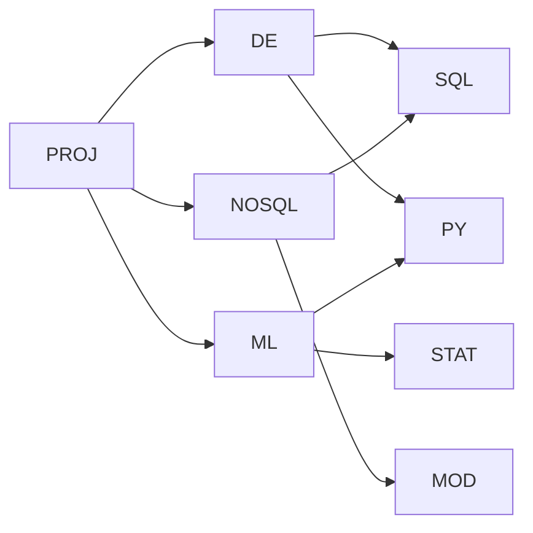

# **Projektübersicht und LE2-Lernziele**

Stand **22.10.2026** · DDI, Mini-Challenge 3 · Elias Pulver und Rodrigo Urech

Lernunterlage zum Projekt. Sie erklärt, wie die Datenbank funktioniert und wo sich die LE2-Lernziele im Code zeigen. Der Abgabebericht ist [mc3-report.md](mc3-report.md).

## **1) Was macht das Projekt?**

Eine Lernpfadplanung für einen erfundenen Weiterbildungsanbieter. Kurse setzen andere Kurse voraus, und jeder Kurs wird mehrmals durchgeführt (Semester, Standort, Lehrperson, Vollzeit oder Teilzeit).

- PROJ → DE heisst, PROJ darf man erst besuchen, wenn DE abgeschlossen ist
- DE hat selbst wieder Vorkurse (SQL, PY), so entsteht eine Kette über mehrere Stufen
- Für PROJ braucht man deshalb alle Kurse rechts davon, PY und SQL zählen dabei nur einmal

| ID | Frage | SQL-Technik |
|---|---|---|
| A-001 | Welche Kurse setzt PROJ direkt voraus? | `JOIN` |
| A-002 | Welche Kurse setzt PROJ insgesamt voraus, über alle Stufen und ohne Duplikate? | `WITH RECURSIVE`, `UNION` |
| A-003 | Welche Kurse darf Person 1 jetzt belegen? | verschachteltes `NOT EXISTS` |
| A-004 | Was fehlt Person 1 für PROJ, und wie viele Stunden sind das? | A-002 minus Abschlüsse, `COUNT`, `SUM` |
| A-005 | Welche Durchführungen davon gibt es in FS27 an Standort 1 in meiner Studienform? | `JOIN` auf A-003 |

## **2) Welche Datei macht was?**

| Datei | Aufgabe |
|---|---|
| `le2-sql/schema.sql` | Tabellen, Constraints, Indizes, Funktionen A-002 bis A-005, Exportansicht |
| `le2-sql/seed.sql` | Beispielbestand `synthetic-v2` (DML) |
| `le2-sql/tests.sql` | 32 Prüfungen, laufen in einer Transaktion mit `ROLLBACK` |
| `le2-sql/queries.sql` | A-001 bis A-005, CRUD-Demo, Ausführungsplan |
| `le2-sql/model/` | konzeptionelles und relationales Modell (`.dot`, `.png`, `.svg`) |
| `src/export.py`, `src/load.py` | Export nach `data/seed.json`, Import aus Datei in PostgreSQL und Neo4j |
| `start.ps1`, `compose.yaml` | Docker, Aufbau, Prüfungen, Abfragen, Messung |

## **3) LE2: Lernziele und Nachweise**

| LE2-Teilziel | Nachweis im Projekt |
|---|---|
| L1 Konzeptionelles und logisches Modell unterscheiden | `conceptual.png` (Chen) und `relational.png` (Tabellen mit PK und FK) |
| L2 Aus einer Problemstellung ein relationales Modell entwickeln | 6 Entitäten, 2 Beziehungstabellen, Selbstbeziehung, 3NF |
| L3 Modell in einer relationalen Datenbank umsetzen | `schema.sql`: `CREATE SCHEMA`, 8 × `CREATE TABLE`, Funktionen |
| L4 Daten hinzufügen, verändern und löschen | `seed.sql`, CRUD-Demo, Tests P25 bis P29 |
| L5 Constraints erstellen | PK, FK (auch zusammengesetzt), `NOT NULL`, `CHECK`, `UNIQUE`, Tests P14 bis P23 |
| L6 Indizes erstellen | 3 × `CREATE INDEX`, dazu PK- und UNIQUE-Indizes, `EXPLAIN ANALYZE` |
| L7 Daten exportieren und importieren | Ansicht `export_data`, `data/seed.json`, Rückimport P24, Dateiimport `tests/test_import.py` |
| L8 Datenmodell anpassen und löschen | `ALTER TABLE ADD/DROP COLUMN`, `CREATE/DROP TABLE` in P30 und P31 |

## **4) Vom Problem zu den Tabellen**

### **4.1) Konzeptionell, logisch, physisch**

| Ebene | Leitfrage | Beispiel |
|---|---|---|
| Konzeptionell | Was gibt es fachlich, und wie hängt es zusammen? | Person belegt Durchführung, Kurs setzt Kurs voraus |
| Logisch | Wie wird das als Tabellen abgebildet? | 8 Tabellen mit PK und FK |
| Physisch | Wie wird es im System umgesetzt? | PostgreSQL-Datentypen, Indizes, Funktionen |

### **4.2) Tabellen**

| Tabelle | Speichert | Primärschlüssel | Fremdschlüssel |
|---|---|---|---|
| `course` | Kurse | `course_id` | – |
| `learner` | Personen mit Studienform | `learner_id` | – |
| `semester` | Semester mit Beginn und Ende | `semester_id` | – |
| `location` | Standorte | `location_id` | – |
| `lecturer` | Lehrpersonen | `lecturer_id` | – |
| `course_run` | Durchführungen | `run_id` | `course_id`, `semester_id`, `location_id`, `lecturer_id` |
| `prerequisite` | Welcher Kurs benötigt welchen | `course_id` + `required_course_id` | beide → `course` |
| `enrollment` | Wer belegt welche Durchführung | `learner_id` + `course_id` | `learner_id` → `learner`, `(run_id, course_id)` → `course_run` |

- **1:N** (Kurs zu Durchführung, Semester zu Durchführung usw.) wird zum Fremdschlüssel auf der N-Seite
- **N:N** (belegt, setzt voraus) wird zu einer eigenen Tabelle
- **Zusammengesetzter FK:** `(run_id, course_id)` verweist auf `UNIQUE (run_id, course_id)` in `course_run`. So kann `course_id` in `enrollment` nicht zu einer falschen Durchführung gehören
- **Leeres Abschlussdatum:** `completed_on IS NULL` bedeutet, die Belegung läuft noch

### **4.3) Normalisierung**

| Normalform | Erklärung | Umsetzung |
|---|---|---|
| 1NF | Ein Feld enthält einen Wert | ein Vorkurs pro Zeile in `prerequisite` |
| 2NF | Nicht-Schlüsselattribute hängen vom ganzen Schlüssel ab | `completed_on` hängt von Person und Kurs ab |
| 3NF | Keine Abhängigkeit über andere Nicht-Schlüsselattribute | Titel nur in `course`, Standortname nur in `location` |

`enrollment` ist in 3NF, aber nicht in BCNF, weil `run_id` die `course_id` bestimmt. Das ist bewusst so, damit der Primärschlüssel die Regel „eine Belegung pro Kurs“ erzwingt.

## **5) Constraints**

| Regel | Zweck | Test |
|---|---|---|
| `PRIMARY KEY` | eindeutige Zeilen, keine Duplikate | P16, P19 |
| `FOREIGN KEY` | Verweise zeigen auf bestehende Zeilen | P14, P15 |
| `CHECK` | Wertebereiche, z. B. Stunden > 0, Studienform VZ/TZ | P17, P18, P20, P21 |
| `UNIQUE` | ein Angebot pro Kurs, Semester, Standort und Studienform | P22 |
| `ON DELETE RESTRICT` | referenzierte Zeilen nicht löschen | P23 |

Ein `CHECK` sieht nur eine Zeile. Zyklen über mehrere Stufen findet `prerequisite_cycles()` (P13, P27).

## **6) Die Abfragen**

- **A-002:** Der Startteil der rekursiven CTE findet die direkten Vorkurse, der rekursive Teil deren Vorkurse. `UNION` entfernt Duplikate, die Rekursion endet, wenn keine neuen Kurse dazukommen
- **A-003:** „Es gibt keinen Vorkurs ohne Abschluss“ wird zu `NOT EXISTS (... WHERE NOT EXISTS ...)`
- **A-004:** Menge aus A-002 minus abgeschlossene Kurse. Für Person 1 sind das **5** Kurse mit **42** Stunden ($10 + 10 + 8 + 8 + 6$)
- **A-005:** Durchführungen im Semester und am Standort, deren Kurs in A-003 vorkommt und deren Studienform zur Person passt

## **7) Transaktionen, Indizes, Export**

- **Transaktion:** `BEGIN`, `COMMIT`, `ROLLBACK`, `SAVEPOINT`. Die Tests rollen jede Änderung zurück. PostgreSQL rollt auch `ALTER TABLE` und `DROP TABLE` zurück
- **Indizes:** PK-Indizes decken die Suche ab Zielkurs ab. `prerequisite_required_idx` dient der Gegenrichtung, `course_run_offer_idx` der Suche nach Semester, Standort und Studienform
- **Export und Import:** `export_data` baut ein JSON aus allen acht Tabellen. P24 liest es in PostgreSQL zurück, `tests/test_import.py` lädt `data/seed.json` in eine leere Datenbank und vergleicht alle Tabellen

## **8) Fragen zum Selbsttest**

- Warum braucht eine N:N-Beziehung eine eigene Tabelle?
- Warum ist `course_id` in `enrollment`, obwohl `run_id` den Kurs schon bestimmt?
- Warum verhindert `CHECK` keinen Zyklus über mehrere Stufen?
- Was bewirkt `UNION` statt `UNION ALL` in der Rekursion?
- Was unterscheidet `UPDATE` von `ALTER TABLE` und `DELETE` von `DROP TABLE`?
- Warum zählt eine laufende Belegung bei A-004 als fehlend?
