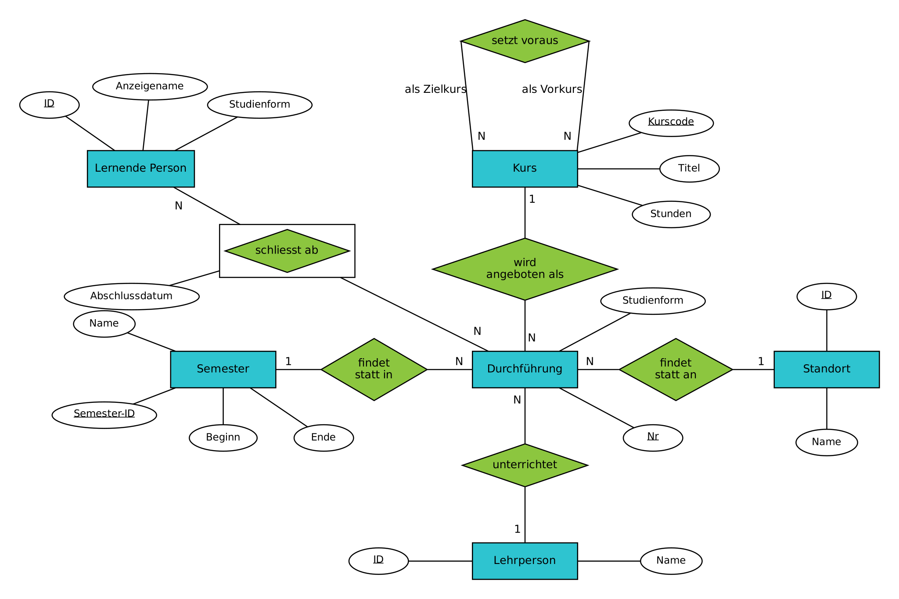
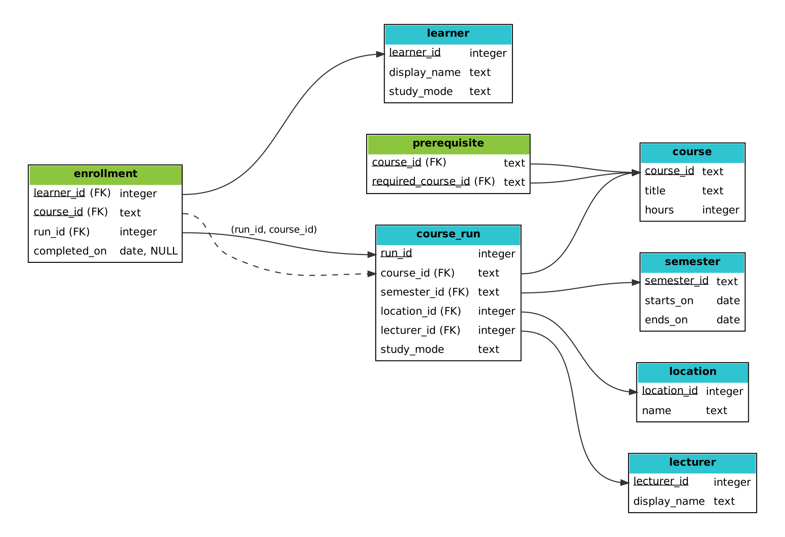
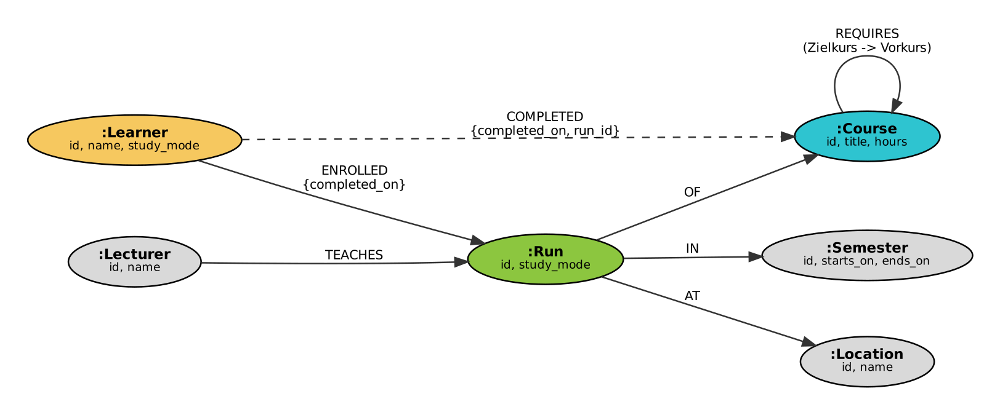
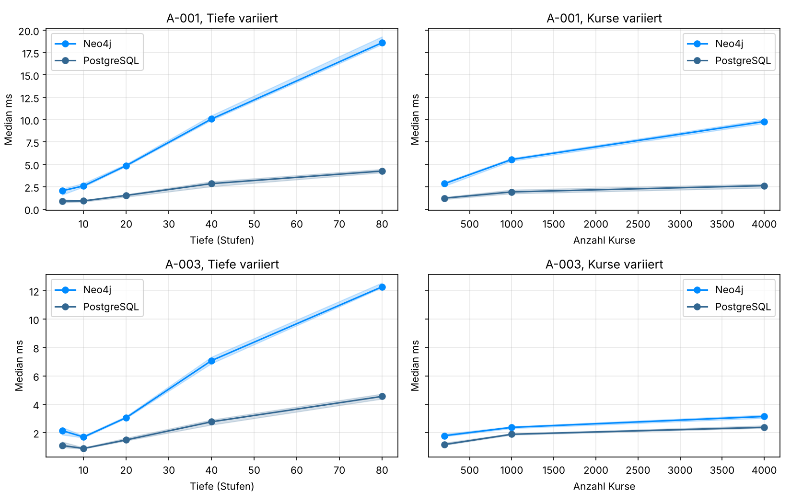

# **Lernpfadplanung mit PostgreSQL und Neo4j**

Mini-Challenge 3, ddi HS 2026 · Elias Pulver, Rodrigo Urech · Stand **22.10.2026**

## **1) Problemstellung**

Ein Weiterbildungsanbieter will Lernenden zeigen, welche Kurse sie als Nächstes besuchen können, was ihnen für ein Ziel noch fehlt und wann und wo die passenden Kurse stattfinden. Viele Kurse setzen andere voraus, oft über mehrere Stufen. Ein Kurs wird mehrmals durchgeführt, jeweils in einem Semester, an einem Standort, mit einer Lehrperson und in Vollzeit oder Teilzeit.

| ID | Frage | Beteiligte Entitäten |
|---|---|---|
| A-001 | Welche Kurse setzt ein Zielkurs direkt voraus? | Kurs |
| A-002 | Welche Kurse setzt ein Zielkurs insgesamt voraus, über alle Stufen und ohne Duplikate? | Kurs |
| A-003 | Welche Kurse darf eine Person als Nächstes belegen, weil sie alle Vorkurse abgeschlossen und den Kurs selbst noch nicht belegt hat? | Lernende Person, Durchführung, Kurs |
| A-004 | Welche Vorkurse fehlen einer Person für einen Zielkurs, und wie viele Stunden sind das? Laufende Belegungen zählen als fehlend | Lernende Person, Durchführung, Kurs |
| A-005 | Welche Durchführungen der Kurse aus A-003 finden in einem Semester an einem Standort in der Studienform der Person statt, und wer unterrichtet sie? | alle sechs |

- **Graphstruktur:** A-002 bis A-005 folgen den Voraussetzungen über eine unbekannte Anzahl Stufen
- **Relational nicht trivial:** sechs Entitäten, eine Selbstbeziehung auf Kurs und ein zusammengesetzter Fremdschlüssel

**Regeln**
- **UND-Bedingung:** Mehrere Voraussetzungen eines Kurses gelten gemeinsam
- **Azyklisch:** Ein Kurs setzt sich weder direkt noch über mehrere Stufen selbst voraus
- **Belegung:** höchstens eine pro Person und Kurs. Ein Abschlussdatum bedeutet abgeschlossen, ohne Datum läuft die Belegung noch
- **Nächster Kurs:** noch nicht belegt, alle direkten und indirekten Voraussetzungen abgeschlossen
- **Keine Doppelzählung:** Ein Vorkurs zählt einmal, auch über mehrere Wege. Der Zielkurs zählt nicht

## **2) Wahl der Datenbanken**

Kern der Problemstellung sind Ketten von Voraussetzungen. Gesucht ist deshalb eine Datenbank, die Beziehungen über viele Stufen direkt verfolgt.

- **Neo4j (NoSQL, Graph):** Kurse, Personen und Durchführungen sind Knoten, Voraussetzungen und Belegungen sind Kanten. Eine Suche über beliebig viele Stufen ist ein einziges Pfadmuster und folgt gespeicherten Kanten statt Joins
- **PostgreSQL 18.6 (relational):** Mit `WITH RECURSIVE` sind mehrstufige Abfragen auch relational möglich. Der Ausgang des Vergleichs ist damit offen

Dokument-, Key-Value- und Column-Datenbanken passen weniger gut. Ein Vorkurs gehört zu vielen Kursen und würde eingebettet dupliziert, und mehrstufige Beziehungen sind dort nicht das zentrale Abfragemuster.

## **3) Konzeptionelles Datenmodell**

Das Modell zeigt die fachliche Sicht ohne Tabellen. Es enthält sechs Entitätstypen.

*Abbildung 1 Konzeptionelles Datenmodell in Chen-Notation*

- **Kurs:** Kurscode, Titel, Stunden
- **Durchführung:** Nr, Studienform. Gehört zu genau einem Kurs, Semester, Standort und einer Lehrperson (je 1:N)
- **Semester, Standort, Lehrperson:** ordnen eine Durchführung zeitlich, örtlich und personell ein
- **Lernende Person:** ID, Anzeigename, Studienform
- **belegt:** N:N zwischen Person und Durchführung mit Abschlussdatum, deshalb als assoziative Entität gezeichnet
- **setzt voraus:** N:N-Selbstbeziehung von Kurs mit den Rollen Zielkurs und Vorkurs

Die Trennung von Kurs und Durchführung ist der zentrale Entscheid. Voraussetzungen gelten für den Kurs, Termine, Orte und Lehrpersonen für die Durchführung.

## **4) Relationale Umsetzung**

Die Umsetzung liegt in `le2-sql/` und wird mit `start.ps1` aufgebaut, geladen und geprüft.

### **4.1) Relationales Modell**

*Abbildung 2 Relationales Modell, Primärschlüssel unterstrichen, Pfeile vom Fremdschlüssel zum Primärschlüssel*

- **Entitäten:** `course`, `learner`, `course_run`, `semester`, `location`, `lecturer`
- **1:N-Beziehungen:** als Fremdschlüssel in `course_run`
- **`prerequisite`:** Selbstbeziehung, beide Spalten Fremdschlüssel auf `course` und zusammen Primärschlüssel
- **`enrollment`:** Beziehung belegt mit `completed_on`. `course_id` wird mitgeführt, damit der Primärschlüssel `(learner_id, course_id)` eine Belegung pro Person und Kurs erzwingt. Der zusammengesetzte Fremdschlüssel `(run_id, course_id)` stellt sicher, dass der Kurs zur Durchführung passt
- **Normalform:** Alle Attribute sind atomar, Titel und Stunden stehen nur in `course`. Das Schema ist in 3NF. `run_id` bestimmt `course_id`, ist aber kein Schlüssel von `enrollment`. Diese bewusste Ausnahme von der BCNF sichert die Regel „eine Belegung pro Kurs“ deklarativ

### **4.2) Datenbank aufbauen und laden**

Schema und Beispielbestand entstehen bei jedem Start neu aus zwei Skripten.

**Daten (synthetic-v2):**
- `semester`: **4** Semester
- `location`: **3** Standorte
- `lecturer`: **4** Lehrpersonen
- `course`: **10** Kurse
- `learner`: **3** Personen
- `prerequisite`: **14** Voraussetzungen
- `course_run`: **17** Durchführungen
- `enrollment`: **8** Belegungen, davon **7** abgeschlossen

**Vorgehen:**
1. `schema.sql` legt Tabellen mit `NOT NULL`, `CHECK`, `UNIQUE` und Fremdschlüsseln an (`ON UPDATE CASCADE`, `ON DELETE RESTRICT`)
2. Indizes für die Gegenrichtung von `prerequisite`, für `enrollment.run_id` und für die Suche nach Semester, Standort und Studienform ergänzen
3. A-002 als rekursive Funktion `all_prerequisites()` umsetzen, A-003 bis A-005 bauen darauf auf
4. `seed.sql` lädt die Daten in einer Transaktion in der Reihenfolge der Fremdschlüssel
5. Die Ansicht `export_data` exportiert alle Tabellen als JSON. Daraus laden Neo4j und der Dateiimport dieselben Daten

**Entscheide**
- **`UNION` statt `UNION ALL`:** Jeder Vorkurs erscheint einmal, und die Rekursion endet auch bei einem Zyklus in fehlerhaften Daten
- **Zyklenprüfung:** Mehrstufige Zyklen kann kein `CHECK` verhindern. `prerequisite_cycles()` prüft sie nach dem Laden

### **4.3) Prüfungen**

`tests.sql` enthält **32** Prüfungen zu Abfragen, Integrität, Export und Import, Datenänderungen und Strukturänderungen. Die Prüfungen laufen in einer Transaktion und hinterlassen keine Änderungen. Auf PostgreSQL sind alle bestanden. Für Person 1 fehlen vor `PROJ` zum Beispiel **5** Vorkurse mit **42** Stunden.

#### **Erkenntnisse**

Die relationale Umsetzung beantwortet alle fünf Abfragen korrekt und setzt die Regeln mit Constraints durch.

**Abfragen**
- Die laufende Belegung von Person 3 in SQL zählt bei A-004 als fehlend (**56** statt **48** Stunden) und wird bei A-003 nicht erneut empfohlen
- A-005 filtert nach Studienform. Person 2 (Teilzeit) erhält in FS27 in Olten nur MOD

**Integrität**
- Abgewiesen werden ungültige Fremdschlüssel, eine Durchführung eines anderen Kurses, eine zweite Belegung desselben Kurses, Selbstvoraussetzungen, Nullstunden, ungültige Studienformen und Semesterdaten sowie das Löschen referenzierter Kurse

**Datenänderungen**
- Export und Rückimport liefern alle acht Tabellen identisch
- `ALTER TABLE ADD COLUMN`, `CREATE TABLE`, `DROP TABLE` und `DROP COLUMN` laufen in einem Savepoint und werden zurückgerollt, weil PostgreSQL auch Strukturänderungen transaktional ausführt

Die Ergebnisse sind die Referenz für Neo4j.

## **5) Umsetzung in Neo4j**

Die Graphumsetzung liegt in `le3-nosql/`. Sie lädt denselben Bestand wie PostgreSQL und beantwortet dieselben fünf Abfragen.

### **5.1) Graphmodell**

Das Modell ist auf die Abfragen ausgerichtet. Jede Abfrage beginnt bei einem Kurs, einer Person oder einem Semester mit Standort und folgt von dort den Kanten.

*Abbildung 3 Property-Graph-Modell in Neo4j*

| Relational | Neo4j |
|---|---|
| `course`, `learner`, `course_run` | Knoten `Course`, `Learner`, `Run` |
| `semester`, `location`, `lecturer` | Knoten `Semester`, `Location`, `Lecturer` |
| `prerequisite` | Kante `(:Course)-[:REQUIRES]->(:Course)` vom Zielkurs zum Vorkurs |
| Fremdschlüssel in `course_run` | Kanten `OF`, `IN`, `AT` und `TEACHES` |
| `enrollment` | Kante `(:Learner)-[:ENROLLED {completed_on}]->(:Run)` |
| abgeschlossene `enrollment` | zusätzlich `(:Learner)-[:COMPLETED]->(:Course)` |

- **Zuordnungstabellen und Fremdschlüssel:** werden zu Kanten, Joins entfallen
- **`COMPLETED`:** abgeleitete Kante. A-003 bis A-005 fragen nach abgeschlossenen Kursen, nicht nach Durchführungen. Die Kante spart pro geprüftem Vorkurs zwei Schritte über `Run`. Dafür muss der Import sie konsistent mit `ENROLLED` anlegen
- **Einstieg:** `id` ist bei allen sechs Labels eindeutig und damit indexiert

### **5.2) Datenbank aufbauen und laden**

**Daten (synthetic-v2):**
- `Course`, `Learner`, `Run`, `Semester`, `Location`, `Lecturer`: Knoten aus den gleichnamigen Tabellen
- `REQUIRES`, `OF`, `IN`, `AT`, `TEACHES`, `ENROLLED`, `COMPLETED`: Kanten

**Vorgehen:**
1. `src/export.py` schreibt den Bestand aus `export_data` nach `data/seed.json`
2. `schema.cypher` legt die Eindeutigkeit der `id` für alle Labels fest
3. `import.cypher` lädt zuerst die Knoten und danach die Kanten, jeweils mit `UNWIND` über die Zeilen einer Tabelle
4. `queries.cypher` enthält A-001 bis A-005 mit denselben Parametern wie die SQL-Funktionen

**Entscheide**
- **Integrität:** Neo4j Community prüft nur die Eindeutigkeit. Fremdschlüssel, Wertebereiche und die Regel „eine Belegung pro Kurs“ prüft PostgreSQL beim Laden. Neo4j übernimmt nur geprüfte Daten
- **A-002:** `WITH DISTINCT` direkt nach dem Pfadmuster `-[:REQUIRES*1..]->` erlaubt Neo4j, jeden Kurs einmal zu besuchen, statt alle Pfade aufzuzählen

## **6) Erwartete Vorteile und Messkriterien**

Wir erwarten, dass Neo4j bei tiefen Voraussetzungsketten schneller ist. In PostgreSQL kostet jede Stufe der Rekursion einen Join über den Index, in Neo4j das Folgen gespeicherter Kanten.

- **H1:** Mit wachsender Tiefe steigt die Antwortzeit von A-002 und A-004 in PostgreSQL stärker als in Neo4j
- **H2:** Die Abfragen sind in Cypher kürzer als in SQL

| Kriterium | Messgrösse |
|---|---|
| K1 Korrektheit | gleiche Ergebnisse in beiden Datenbanken, Voraussetzung für alle weiteren Kriterien |
| K2 Antwortzeit | A-002 und A-004 inklusive Ergebnisübertragung zum Client, Median in ms |
| K3 Skalierung | Verlauf von K2 bei wachsender Tiefe und wachsender Anzahl Kurse |
| K4 Abfrageumfang | Zeilen und Klauseln pro Abfrage, in SQL inklusive aufgerufener Funktionen |

## **7) Messung**

Gemessen wird mit erzeugten Datensätzen, weil der Beispielbestand für Zeitmessungen zu klein ist.

### **7.1) Messdaten und Ablauf**

Die Messdaten bilden lange Ketten mit mehreren Wegen zum selben Vorkurs nach. Sie werden mit festem Seed erzeugt und in beide Datenbanken geladen.

**Daten (benchmark):**
- `course`: Kurse in Stufen, Tiefe **5** bis **80** bei **20** Kursen pro Stufe sowie **20** bis **400** Kurse pro Stufe bei Tiefe **10**
- `prerequisite`: jeder Kurs ab Stufe 1 benötigt zwei Kurse der Stufe darunter, die Hälfte zusätzlich einen Kurs einer tieferen Stufe
- `learner`, `enrollment`: **20** Personen, Person 1 hat die untere Hälfte der Stufen abgeschlossen

**Vorgehen:**
1. Datensatz erzeugen, in beide Datenbanken laden und K1 prüfen (`src/benchmark.py`)
2. **5** Aufwärmläufe, danach **20** gewertete Läufe pro Abfrage und Datenbank, Reihenfolge abwechselnd
3. Zeit inklusive Ergebnisübertragung im Python-Client messen, Median im Notebook auswerten

Beide Datenbanken laufen in Docker auf demselben Rechner. Der Median ist robust gegen einzelne Ausreisser, Abfragen über **120 s** gelten als Timeout.

### **7.2) Abfrageumfang (K4)**

`src/k4.py` zählt Codezeilen und Klauseln. SQL zählt mit allen aufgerufenen Funktionen, Cypher enthält zusätzlich die Sortierung.

| Abfrage | SQL Zeilen | SQL Klauseln | Cypher Zeilen | Cypher Klauseln |
|---|---:|---:|---:|---:|
| A-002 | 13 | 12 | 5 | 5 |
| A-003 | 29 | 31 | 9 | 10 |
| A-004 | 22 | 23 | 7 | 8 |
| A-005 | 38 | 37 | 12 | 13 |

#### **Erkenntnisse**

Die Cypher-Abfragen sind etwa **dreimal** kürzer, H2 trifft damit zu.

- **Ursache:** Das Pfadmuster `-[:REQUIRES*1..]->` ersetzt die rekursive CTE mit Startteil, rekursivem Teil und Join auf `course`
- **Grenze:** Kürzer heisst nicht automatisch verständlicher. Die SQL-Funktionen werden einmal geschrieben und in A-003 bis A-005 wiederverwendet

### **7.3) Messresultate (K1 bis K3)**

Gemessen wurde am **22.10.2026** auf einem Windows-11-Rechner mit Docker Desktop. PostgreSQL 18.6 und Neo4j 5.26.0 Community liefen gleichzeitig, der Client war Python 3.13.

**Daten (benchmark):**
- `course`: **100** bis **4'000** Kurse in acht Szenarien
- `prerequisite`: **192** bis **8'803** Voraussetzungen
- `enrollment`: Abschlüsse von Person 1 in der unteren Hälfte der Stufen

| Reihe | Tiefe | Kurse | A-002 Zeilen | A-002 PostgreSQL | A-002 Neo4j | A-004 Zeilen | A-004 PostgreSQL | A-004 Neo4j |
|---|---:|---:|---:|---:|---:|---:|---:|---:|
| Tiefe | 5 | 100 | 27 | 1.06 | 3.09 | 6 | 1.14 | 2.79 |
| Tiefe | 10 | 200 | 111 | 1.28 | 4.51 | 27 | 1.31 | 4.09 |
| Tiefe | 20 | 400 | 280 | 2.04 | 7.19 | 103 | 2.01 | 5.71 |
| Tiefe | 40 | 800 | 636 | 3.13 | 12.35 | 270 | 3.02 | 10.73 |
| Tiefe | 80 | 1'600 | 1'339 | 5.13 | 22.98 | 612 | 5.29 | 14.69 |
| Breite | 10 | 200 | 111 | 1.43 | 3.55 | 27 | 1.43 | 2.35 |
| Breite | 10 | 1'000 | 327 | 2.36 | 6.99 | 31 | 2.59 | 3.54 |
| Breite | 10 | 4'000 | 690 | 3.34 | 12.69 | 30 | 3.16 | 4.86 |

*Median aus 20 Läufen in ms, Zeit inklusive Ergebnisübertragung zum Client. Reihe Breite heisst Tiefe 10 mit wachsender Anzahl Kurse pro Stufe*

*Abbildung 4 Median mit Interquartilsbereich bei wachsender Tiefe (links) und wachsender Anzahl Kurse (rechts)*

#### **Erkenntnisse**

Beide Datenbanken liefern in allen Szenarien dieselben Ergebnisse, und PostgreSQL ist überall schneller.

**K1 Korrektheit**
- In allen **8** Szenarien sind die Ergebnisse von A-002 und A-004 identisch, kein Lauf erreichte den Timeout

**K2 Antwortzeit**
- PostgreSQL ist bei A-002 **2.5** bis **4.5** Mal und bei A-004 **1.4** bis **3.6** Mal schneller
- Der Interquartilsbereich liegt überall unter **2 ms**. Einzelne Ausreisser von Neo4j bis **48 ms** beeinflussen den Median nicht

**K3 Skalierung**
- Von Tiefe **5** auf **80** steigt A-002 in PostgreSQL von **1.06** auf **5.13 ms**, in Neo4j von **3.09** auf **22.98 ms**
- Beide Zeiten wachsen ungefähr linear mit der Anzahl zurückgegebener Zeilen. Pro Zeile kommen in PostgreSQL etwa **0.003 ms**, in Neo4j etwa **0.015 ms** dazu
- Bei A-004 mit **4'000** Kursen, aber nur **30** Ergebniszeilen, ist der Abstand am kleinsten (Faktor **1.5**)

Die Unterschiede hängen stärker an der Grösse des Ergebnisses als an der Tiefe der Kette.

## **8) Vergleich und Interpretation**

Die Messung widerlegt unsere Erwartung an die Antwortzeit, bestätigt aber den Vorteil bei der Formulierung der Abfragen.

| Hypothese | Ergebnis | Beleg |
|---|---|---|
| H1 Neo4j skaliert mit der Tiefe besser | nicht bestätigt | Der Faktor bei A-002 wächst von **2.9** (Tiefe 5) auf **4.5** (Tiefe 80) zugunsten von PostgreSQL |
| H2 Cypher ist kürzer | bestätigt | Cypher braucht etwa einen Drittel der Zeilen und Klauseln |

**Antwortzeit**
- **Mengenverarbeitung:** Die rekursive CTE verarbeitet pro Stufe alle neu gefundenen Kurse gemeinsam in einem Join. A-002 erreicht bei Tiefe 80 **1'339** von **1'600** Kursen, die Abfrage liest also fast den ganzen Graphen. Hier ist mengenorientierte Verarbeitung im Vorteil gegenüber dem Folgen einzelner Kanten
- **Datenmenge:** Mit höchstens **8'803** Voraussetzungen liegen alle Daten im Arbeitsspeicher. Der Vorteil gespeicherter Kanten in Neo4j zeigt sich vor allem, wenn eine Abfrage nur einen kleinen Teil eines grossen Graphen berührt
- **Übertragung:** Die Zeit pro Ergebniszeile ist in Neo4j etwa fünfmal höher. Ob das am Server oder am Python-Treiber liegt, trennt unsere Messung nicht, weil sie die Zeit am Client misst

**Weitere Kriterien**
- **Abfragen:** Das Pfadmuster `-[:REQUIRES*1..]->` drückt die Kette direkt aus, die SQL-Funktionen brauchen Startteil, Rekursion und Joins
- **Integrität:** PostgreSQL setzt Fremdschlüssel, Wertebereiche und die Regel „eine Belegung pro Kurs“ selbst durch. Neo4j Community prüft nur die Eindeutigkeit, der Rest hängt am Import

**Grenzen**
- Ein Rechner, Docker Desktop unter Windows, Standardeinstellungen beider Datenbanken
- Erzeugte Graphen mit fester Struktur, nur lesende Abfragen, keine gleichzeitigen Zugriffe
- Zeit am Client inklusive Treiber, keine getrennte Serverzeit

Für diese Problemstellung und Datenmenge ist PostgreSQL die schnellere und strengere Lösung. Neo4j bildet die Kette natürlicher ab und erlaubt kürzere Abfragen. Ob Neo4j bei deutlich grösseren Graphen oder bei Abfragen wie dem kürzesten Lernpfad aufholt, wäre mit weiteren Messungen zu prüfen.

## **9) Vorkenntnisse und Lernerfolg**

### **9.1) Elias Pulver**

- **Vorkenntnisse aus dem Beruf:** wird von Elias ergänzt
- **Wichtigste Erkenntnis:** wird von Elias ergänzt
- **Einflüsse auf den Lernerfolg:** wird von Elias ergänzt

### **9.2) Rodrigo Urech**

- **Vorkenntnisse aus dem Beruf:** wird von Rodrigo ergänzt
- **Wichtigste Erkenntnis:** wird von Rodrigo ergänzt
- **Einflüsse auf den Lernerfolg:** wird von Rodrigo ergänzt
