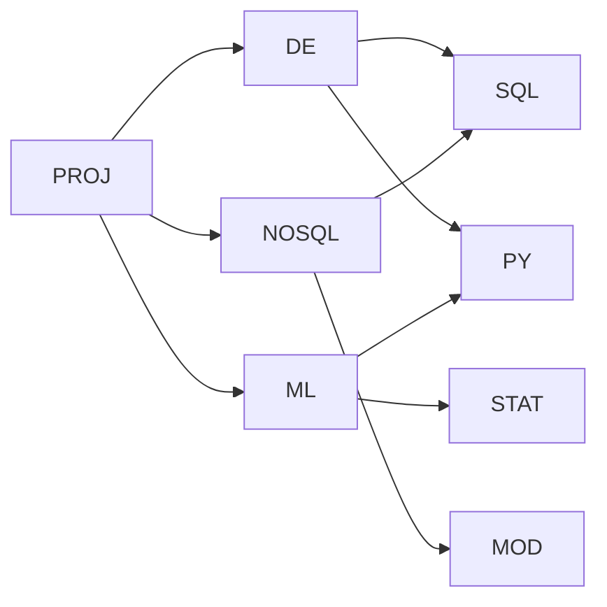

# **Review-Meeting 22.10.2026**

## **1) Aufgabenstellung**

- Lernpfadplanung für einen erfundenen Weiterbildungsanbieter
- Kurse setzen andere Kurse voraus, über mehrere Stufen
- Vergleich von PostgreSQL (relational) und Neo4j (Graph, NoSQL) mit denselben Daten und denselben Abfragen

- PROJ → DE heisst, PROJ darf man erst besuchen, wenn DE abgeschlossen ist
- DE hat selbst wieder Vorkurse (SQL, PY), so entsteht eine Kette über mehrere Stufen
- Für PROJ braucht man deshalb alle Kurse rechts davon, PY und SQL zählen dabei nur einmal

## **2) Abfragen**

| ID | Frage | SQL-Technik |
|---|---|---|
| A-001 | Welche Kurse setzt PROJ direkt voraus? | `JOIN` |
| A-002 | Welche Kurse setzt PROJ insgesamt voraus, über alle Stufen und ohne Duplikate? | `WITH RECURSIVE`, `UNION` |
| A-003 | Welche Kurse darf Person 1 als Nächstes besuchen? | verschachteltes `NOT EXISTS` |
| A-004 | Was fehlt Person 1 für PROJ, und wie viele Stunden sind das? | A-002 minus Abschlüsse, `COUNT`, `SUM` |

| Beispieldaten | Anzahl | Bedeutung |
|---|---:|---|
| Kurse | 10 | z. B. PROJ, DE, SQL, jeweils mit Titel und Stunden |
| Personen | 3 | Lernende A, B und C |
| Voraussetzungen | 14 | Zeilen der Form „Kurs X benötigt Kurs Y“ |
| Abschlüsse | 7 | Zeilen der Form „Person hat Kurs am Datum abgeschlossen“ |

*Person 1 (Lernende A) hat bereits EIN, SQL und MOD abgeschlossen. Alle Daten und Stunden sind frei erfunden.*

## **3) Messkriterien**

| Kriterium | Messgrösse | Wie gemessen |
|---|---|---|
| K1 Korrektheit | Gleiche Ergebnisse und Stundensummen | Ergebnisse von A-001 bis A-004 in beiden Datenbanken abgleichen |
| K2 Antwortzeit | Median in ms für A-002 und A-004 | Wiederholte Läufe nach Aufwärmläufen, inklusive Ergebnisübertragung |
| K3 Skalierung | Verlauf von K2 | Erzeugte Datensätze mit wachsender Tiefe und Kurszahl |
| K4 Abfrageumfang | Zeilen und Klauseln | SQL- und Cypher-Abfragen auszählen |

| Hypothese | Begründung |
|---|---|
| H1 Neo4j ist bei tiefen Ketten schneller | SQL braucht pro Stufe einen Join, Neo4j folgt nur einer Kante |
| H2 Cypher-Abfragen sind kürzer | Pfadmuster statt rekursiver CTE |

*K1 ist Voraussetzung für K2 bis K4. Der Beispielbestand ist für Messungen zu klein.*

## **4) Modelle**

| Tabelle | Speichert | Primärschlüssel | Fremdschlüssel |
|---|---|---|---|
| `course` | Kurse | `course_id` | – |
| `learner` | Personen | `learner_id` | – |
| `completion` | Wer hat welchen Kurs abgeschlossen | `learner_id` + `course_id` | `learner_id` → `learner`, `course_id` → `course` |
| `prerequisite` | Welcher Kurs benötigt welchen | `course_id` + `required_course_id` | beide → `course` |

### **Geplantes Neo4j-Modell**

| Relational | Neo4j | Eigenschaften |
|---|---|---|
| `course` | Knoten `Course` | `id`, `title`, `hours` |
| `learner` | Knoten `Learner` | `id`, `display_name` |
| `prerequisite` | Kante `(:Course)-[:REQUIRES]->(:Course)` | Richtung Zielkurs zu Vorkurs |
| `completion` | Kante `(:Learner)-[:COMPLETED]->(:Course)` | `completed_on` |

## **5) Stand**

| Bereich | Ist | Soll |
|---|---|---|
| PostgreSQL (LE2) | fertig, 25/25 Tests | fertig |
| Neo4j (LE3) | nur Modell | Daten geladen, 4 Abfragen |
| Messung | Kriterien definiert | Resultate vorhanden |
| Bericht | Draft | Vergleich und Reflexion |
