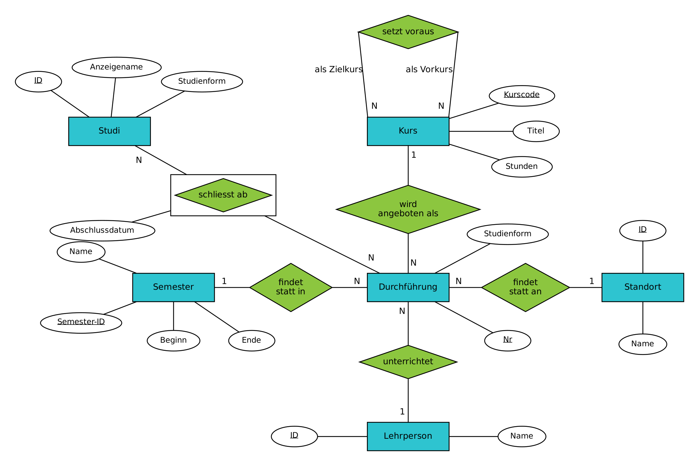
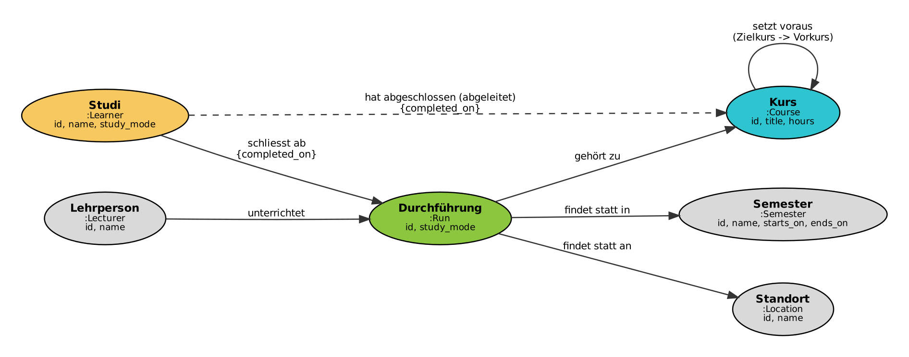

# **MC3 - Draft LE3**

## **1) Problemstellung**
Das Modell wurde gemäss Feedback vom **22.10.** auf 6 Entitäten erweitert

- Studierende sollen sehen, welche Kurse sie als Nächstes belegen dürfen, was ihnen für ein Ziel noch fehlt und wo und bei wem ein Kurs stattfindet. 
- Kurse setzen andere Kurse über mehrere Stufen voraus.

  - **Kurs** (Kurscode, Titel, Stunden)
  - **Durchführung** (ein Kurs in einem Semester, an einem Ort, mit einer Lehrperson)
  - **Semester**
  - **Standort** 
  - **Lehrperson**
  - **Studi**

| ID | Frage |
|---|---|
| A-001 | Welche Kurse müssen über alle Stufen abgeschlossen sein, um Kurs X zu belegen? |
| A-002 | Welche Kurse darf ein Studi als Nächstes belegen? |
| A-003 | Welche Kurse fehlen einem Studi noch für Kurs X? |
| A-004 | Wo und bei wem kann ein Studi Kurs X im Semester Y besuchen? |
| A-005 | Welche Kurse unterrichtet eine Lehrperson im Semester Y? |

## **2) Wahl der NoSQL-Datenbank**

- **Neo4j:** Voraussetzungsketten sind ein Graph. Eine Suche über beliebig viele Stufen ist ein einziges Pfadmuster `-[:REQUIRES*1..]->`
- **Andere Typen:** Dokument-, Key-Value- und Column-Datenbanken passen weniger, weil ein Vorkurs zu vielen Kursen gehört und mehrstufige Beziehungen dort kein zentrales Abfragemuster sind
- **Erwarteter Vorteil:** Neo4j folgt gespeicherten Kanten, PostgreSQL braucht pro Stufe einen weiteren Join

## **3) Graphmodell**

- **Knoten:** Kurs `Course`, Studi `Learner`, Durchführung `Run`, Semester `Semester`, Standort `Location`, Lehrperson `Lecturer`, jeweils mit eindeutiger `id`
- **Kanten:** `REQUIRES` vom Zielkurs zum Vorkurs, `OF`, `IN`, `AT` und `TEACHES` für die Durchführung, `ATTENDED {completed_on}` für Abschlüsse
- **Abfrageoptimierung:** Die abgeleitete Kante `COMPLETED` führt direkt vom Studi zum abgeschlossenen Kurs. Bei A-002 senkt sie die db hits von **2'344'680** auf **853'478** und die Zeit von **240** auf **128 ms**

## **4) Umsetzung Neo4j**

- **Import:** derselbe Datenbestand wie in PostgreSQL, als JSON exportiert und mit `UNWIND` geladen
- **Abfragen:** A-001 bis A-005 in Cypher mit denselben Parametern wie die SQL-Funktionen
- **Korrektheit:** Ein automatischer Test vergleicht alle Abfragen mit allen Parametern, beide Datenbanken liefern dieselben Ergebnisse
- **Aufbau:** beide Datenbanken in Docker, reproduzierbar über ein Startskript

